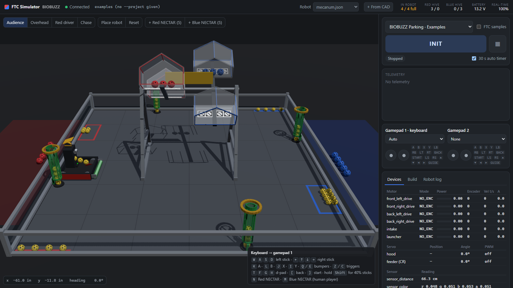

# FTC Simulator

[](https://github.com/leelening/ftc-sim/actions/workflows/windows.yml)
[](https://github.com/leelening/ftc-sim/actions/workflows/ubuntu.yml)
[](https://github.com/leelening/ftc-sim/actions/workflows/macos.yml)

Run your real FTC robot code (the `TeamCode` in your FtcRobotController project) against a
simulated robot on the **BIOBUZZ** (2026–27) field. Drive it from a browser Driver Station with
an Xbox/PlayStation controller or the keyboard. When it works in the simulator, deploy the
same code to the robot as usual. Nothing in TeamCode changes.



## Quick start

1. Install a JDK 17 or newer (Android Studio's bundled JDK works, or [Temurin](https://adoptium.net)).
   `run-sim.bat` also finds a JDK unpacked in `%USERPROFILE%\.jdks`.
2. Start the simulator with your robot project:

   ```bat
   .\run-sim.bat --project "C:\path\to\FtcRobotController"
   ```

   On macOS and Linux: `sh run-sim.sh --project ~/FtcRobotController`. Without `--project` it
   runs the bundled examples and the official FTC samples.
3. Your browser opens at <http://localhost:8080>. Pick an OpMode, press **INIT**, then **▶ START**.

To avoid typing the path every time, copy `sim.properties.example` to `sim.properties` and set
`project=`.

## Several robots on one field

Up to four robots can share the field, two per alliance, as in a match. Each one is a separate
Robot Controller with its own TeamCode, OpMode, gamepads, telemetry and robot file. The robots
collide with each other, push each other and see each other with their distance sensors.

```bat
rem two robots running the bundled examples, to try it out
.\run-sim.bat --robots 2

rem your own code on two robots, as opponents (robot 1 red, robot 2 blue)
.\run-sim.bat --project "C:\path\to\FtcRobotController" --robots 2

rem your own code on two robots on the same alliance
.\run-sim.bat --project "C:\path\to\FtcRobotController" --robots 2 --alliance2 red

rem two projects: robot 1 runs one, robot 2 the other
.\run-sim.bat --project "C:\path\to\FtcRobotController" --project2 "C:\path\to\OtherFtcRobotController"

rem a full match: two red and two blue robots
.\run-sim.bat --project "C:\path\to\FtcRobotController" --robots 4
```

| Option | Sets |
|---|---|
| `--robots N` | number of robots (1–4). Robots without options of their own run robot 1's project and robot file |
| `--project2 DIR` … `--project4 DIR` | that robot's FtcRobotController project |
| `--robot2 FILE` … `--robot4 FILE` | that robot's description |
| `--alliance red\|blue`, `--alliance2` … `--alliance4` | that robot's alliance. Default: robot 1 red, robot 2 blue, robot 3 red, robot 4 blue |

The same keys work in `sim.properties`:

```properties
robots=2
project2=C:/path/to/OtherFtcRobotController
robot2=robots/tank.json
alliance2=red
```

### Two projects

Give each robot its own FtcRobotController folder with `--project2` (and `--project3`,
`--project4`). Any FtcRobotController folder works: a teammate's repository, another team's, or a
second clone of the official one.

- **Separate builds.** The simulator compiles each folder's `TeamCode/src/main/java` (and its
  FTC samples) on its own. Both projects can have classes with the same name, and static fields
  in one robot's code never affect the other robot.
- **Separate OpMode lists.** Each robot's Driver Station lists only its own project's OpModes. Its
  *Build* tab shows which folder it compiles and which files were skipped.
- **Separate rebuilds.** Saving a file in one project rebuilds only the robots that run it. If such
  a robot's OpMode is running, its rebuild waits until it stops; the other robots keep going.
- **Separate hardware.** `--robot2` gives robot 2 its own robot file. The device names in each
  project must match its robot's file.
- **Deploying.** The simulator never writes to either folder, so each project deploys to its own
  real robot as usual.

### Alliance partners and opponents

Robots alternate between the alliances by default (robot 1 red, robot 2 blue, and so on). Put two
robots on the same alliance with `--allianceN`, for example `--alliance2 red` to practice with an
alliance partner. An alliance has at most two robots.

- **Starting spots.** The robot file's `start` is the first spot of the red alliance. The red
  alliance's second robot starts beside it, mirrored across the field's center line. The blue
  spots are the red ones turned half a turn about the field center, as the field itself is. With
  `robots/mecanum.json` the red robots start 61 in from the center by the red wall, at y = −11.8 in
  and +11.8 in, facing the blue wall; the blue robots start at the matching spots by the blue wall.
- **Pre-loads.** Every simulated robot starts with its 4 POLLEN. A LOADING ZONE holds the pre-loads
  of its alliance's robots that aren't on the field: none when both of its robots are simulated.
- **Telling them apart.** With more than one robot, each robot's side plates take its alliance
  color and a numbered marker floats above it.

### Driving several robots

- **A card per robot.** The side panel starts with a card for every robot: its name and alliance,
  its state and time (an Autonomous with the 30 s timer counts down, e.g. *Running · 0:28 left*),
  its OpMode list, its INIT / START / STOP button and a stop button. If that robot's code throws an
  error, the error appears in its card, with *Dismiss* (and *Use tank.json* when another robot
  file has the missing device).
- **Starting a match.** Below the cards, *INIT all* initializes every stopped robot's selected
  OpMode, *START all* starts every robot in INIT at the same moment (so their 30 s timers line up),
  and *STOP all* stops them all. Each card's own buttons still start and stop that robot alone.
  *30 s auto timer* and *FTC samples* (also list the SDK's sample OpModes) apply to every robot.
- **The selected robot.** Click a robot's card to show its telemetry, gamepads, devices, build and
  log below; that card is outlined, and the section titles name the robot
  (*Telemetry · Robot 2*). The top bar shows that robot's TeamCode folder and robot file, and
  *Place robot* and the chase camera act on it.
- **Reset** starts a new match: every robot back at its start and the game pieces restaged, once
  every OpMode has stopped.
- **Controllers.** With *Auto*, the first controller drives robot 1's gamepad 1, the second
  controller robot 2's gamepad 1, and so on. The keyboard drives the robot on screen if it has no
  controller. Each robot's gamepad pickers can override this. Two drivers at one computer should
  share one browser window: browsers may send controller input only to the window in focus.
- **One window per driver.** `http://localhost:8080/?robot=2` opens a page that shows and drives
  only robot 2, for example on a second screen. Give each robot its own `?robot=N` page; a page
  without `?robot` sends input for every robot.
- **Kept apart.** Robots running the same project still get separate copies of TeamCode, so static
  fields aren't shared. `OpMode.blackboard`, `RobotLog`'s global error, and the bus latency from
  the robot file are also per robot.

## The edit → simulate → robot loop

- Edit TeamCode in Android Studio or VS Code as you normally do. When you save, the simulator
  recompiles within a second or two and the OpMode list refreshes. If an OpMode is running, the
  rebuild waits until you stop it.
- TeamCode is compiled the way Android Studio compiles it: **Java 8**, against the **FTC SDK 12.0**
  API. An automated test checks the simulator's SDK against the official SDK 12.0 jars, class by
  class and method by method, so code that compiles here also compiles for the robot.
- Files that use something the simulator does not model (for example `VisionPortal`, or
  Android UI classes) are skipped and listed under **Build** with the reason. Everything else still
  runs.
- Never import `ftcsim.*` in TeamCode. Those are simulator internals that don't exist on the robot,
  and the simulator refuses to build a file that uses them.
- Deploy to the robot with your usual tools. The simulator never writes to your project.

## Driving

**Controller.** Plug in or pair an Xbox or PlayStation controller, click the simulator page, and
**press any button**: browsers only expose a controller after a button press. *Gamepad 1 = Auto*
uses the first controller. Rumble (`gamepad1.rumble(...)`, `rumbleBlips(...)`) plays on the
controller in Chrome and Edge (Firefox has no controller rumble), so use Chrome or Edge on any
operating system. The Xbox Guide button may be taken by the Windows Game Bar.

**Keyboard** (used for gamepad 1 when no controller is present, or pick *Keyboard* for either slot):

| Keys | Gamepad |
|---|---|
| W A S D | left stick (W = forward) |
| ← ↑ ↓ → | right stick |
| K · L · J · I | A · B · X · Y |
| Q · E | left / right bumper |
| Z · C | left / right trigger |
| T F G H | d-pad up / left / down / right |
| [ · ] | back · start |
| hold Shift | sticks at 40 % |

With one controller, set **Gamepad 2 → Keyboard** to try two-driver code.

**The example BIOBUZZ TeleOp** (`examples/teamcode`, default robot):

| Control | Does |
|---|---|
| left stick | drive. Robot-centric: forward = toward the intake, whichever way the robot faces |
| right stick X | turn |
| BACK / View (`[`) | switch to field-centric and back (forward = away from the driver, whichever way the robot faces) |
| A (`K`) | field-centric: make "away from the driver" the way the robot faces now |
| RT / LT (`C` / `Z`) | intake in / out |
| Y (`I`) | launcher on/off; the controller rumbles when it is up to speed |
| RB (`E`) | shoot (only once the launcher is up to speed) |
| d-pad up/down (`T` / `G`) | raise / lower the hood |

## The Driver Station panel

- **OpMode list** with Autonomous and TeleOp groups. Tick *FTC samples* to show the FTC SDK samples,
  which are `@Disabled` on a real robot.
- **INIT / START / STOP** with the same rules as the real app. The optional **30 s auto timer** stops
  Autonomous OpModes and then preselects the TeleOp named in `preselectTeleOp`.
- **Errors** appear the way the Driver Station shows them, e.g.
  `User code threw an uncaught exception: IllegalArgumentException - Unable to find a hardware device with name "left_drive" and type DcMotor (at MyOpMode.init:42)`.
- **Telemetry**, including `telemetry.log()`, `Func` items, retained items, the 250 ms transmission
  interval and the HTML display format.
- **Devices**: every motor's mode, power, encoder, velocity and current; servo positions; sensor
  readings; hub LED and bulk-caching mode. **Robot log** shows `RobotLog` and `android.util.Log`.
- **3D view**: audience, overhead, red-driver and chase cameras. *Place robot* puts the robot
  anywhere (drag to aim it). *Reset* power-cycles it, which resets encoders and the IMU heading,
  puts it back at its start and restages the game pieces.

## Describing your robot

Robots are JSON files in `robots/`. Choose one with `--robot` or from the top bar.
**Device names must match your robot configuration on the Driver Station**, because your code
looks devices up by those names.

- `robots/mecanum.json`: 18 in mecanum robot (goBILDA 312 RPM, 104 mm wheels) using the SDK 12
  sample names `front_left_drive` …, plus `imu`, `pinpoint`, `sensor_otos`, `sensor_distance`,
  `sensor_color`, `sensor_touch`, `digitalTouch`, and a BIOBUZZ-style `intake`, `launcher`
  (flywheel), `hood` servo and `feeder` CR servo.
- `robots/tank.json`: six-wheel drop-center tank with `left_drive` / `right_drive`, an arm
  (`left_arm`, also `arm`) and claw servos (`left_hand`, `right_hand`), for the classic samples.

Main fields (meters and degrees; robot frame +x forward, +y left, +z up):

| Section | What it sets |
|---|---|
| `chassis` | size, mass, color |
| `drive` | `type` (`mecanum`, `tank`, `tank4`), wheel diameter, wheelbase, track width, `motor` model, external gear ratio, motor names, grip |
| `imu` | name and how the Control Hub is mounted (`logo`, `usb`, same words as `RevHubOrientationOnRobot`) |
| `devices` | `motor` (with a `load`: `roller`, `flywheel`, `arm` with gravity and hard stops, `slide`), `servo`, `crservo`, `pinpoint` (pod offsets, pod type), `otos`, `distance`, `color`, `touch`, `digital_touch`, `webcam`; each with a mounting position and an optional `role` for the 3D model |
| `io` | simulated bus latency (default 1 ms per hub command, 2.5 ms per I2C read) |
| `start` | starting pose `[x, y, heading]` on the field |

Motor models come from vendor datasheets: goBILDA 5203 (all ratios), REV HD Hex (spur and
UltraPlanetary), REV Core Hex, NeveRest, TETRIX. If you mount a sensor differently from what
your code assumes (for example the IMU orientation or the Pinpoint pod offsets), the readings
are wrong in the same way they would be on the robot.

## What is simulated

- **Physics** uses [ODE4j](https://github.com/tzaeschke/ode4j) at 1 kHz in real time. The robot
  is a chassis plus one body per wheel. Each mecanum wheel grips only along its roller axis, which
  is the standard way Gazebo models mecanum wheels, so strafing, wheel slip and pushing against
  walls behave physically. The robot collides with the walls, the HIVE structure's A-frames and
  the FLOWERS.
- **Motors** follow their torque-speed curve, sag the battery under load, and BRAKE/FLOAT
  correctly. The **hub firmware** implements `RUN_WITHOUT_ENCODER`, `RUN_USING_ENCODER`
  (velocity PIDF), `RUN_TO_POSITION`, `STOP_AND_RESET_ENCODER`, `setVelocity`, PIDF tuning,
  current and over-current, and **bulk caching** (`OFF` / `AUTO` / `MANUAL`). Encoders don't
  reset between OpModes, just as on a real robot.
- **Sensors**: the Control Hub IMU (`IMU`, yaw/pitch/roll, angular velocity, mounting
  orientation), goBILDA Pinpoint (its own odometry from your offsets, resolution and directions),
  SparkFun OTOS, REV 2m distance (raycast), REV Color Sensor V3 (tape and tiles under it), REV
  touch sensor / digital channel, and battery voltage.
- **Game pieces**: the 40 yellow POLLEN (7.1 cm) and 8 red + 8 blue NECTAR (9.1 cm), staged
  as Competition Manual section 10.3.1 sets them up: 4 POLLEN in each FLOWER, 4 in each GARDEN and
  4 pre-loaded in each simulated robot; the absent robots' pre-loads sit in the middle of their
  LOADING ZONE against the wall; 3 NECTAR in each upward-facing CELL and 5 in each ALLIANCE AREA. Loose
  balls roll and bounce, slow down with air drag in flight and rolling resistance on the tiles,
  and the robot pushes them. A robot with an `intake` role picks up balls
  in front of its roller (reverse it to spit one out) and holds at most 4 (rule G407); a `feeder`
  then sends them into the `launcher`, which throws them at about half the flywheel's surface
  speed, at an angle set by the `hood` servo. Balls in FLOWERS, CELLS and ALLIANCE AREAS stay put
  (those holders are not modeled as containers yet). *Reset* also resets the game pieces.
- **OpMode lifecycle**: iterative and linear OpModes, `waitForStart`, `opModeInInit`,
  `isStopRequested`, thread interruption on STOP, `requestOpModeStop`, `terminateOpModeNow`,
  `OpMode.blackboard`. When an OpMode ends, motors stop and servos go limp.
- **Loop timing**: hardware calls take about as long as on a real Control Hub, so control-loop
  tuning carries over.

**Not simulated yet**: VisionPortal / AprilTag / color-blob processing, scoring, taking POLLEN
out of a FLOWER, human-player NECTAR, the HIVE tipping, LEDs and sounds, Limelight, OctoQuad, legacy BNO055 / Modern Robotics sensors.
OpModes that use them are skipped at build time with the reason.

## Checking the simulator itself

```bat
gradlew test
```

The suite includes:

- `ApiConformanceTest`: the simulator's SDK must be a subset of the official FTC SDK 12.0. It
  downloads the official jars from Maven Central.
- `GameElementsTest`: POLLEN and NECTAR counts and staging per section 10.3.1, balls at rest,
  pushing, intake (4-ball limit) and launching.
- `DrivetrainPhysicsTest`, `RestDriftTest`: speed, strafing, turning, RUN_TO_POSITION, wall
  contact, no drift at rest.
- `MultiRobotTest`: two robots on one field. Each has its own TeamCode class loader, starting
  spot, pre-load, blackboard and gamepads; one robot pushes the other; swapping one robot's file
  leaves the other alone; alliance partners start side by side and an alliance takes at most two
  robots; *INIT all* / *START all* / *STOP all* run both robots' Autonomous together.
- `SampleOpModesTest`, `ExampleOpModesTest`: the official samples and the examples run end to
  end. For example, `RobotAutoDriveByGyro_Linear` returns to within about 10 cm of its start, the
  Pinpoint auto to within 0.2 in, and the BIOBUZZ TeleOp's shots peak at HIVE CELL height
  (1.4–1.9 m).

On GitHub, these tests run on Windows, Ubuntu and macOS (JDK 21, plus JDK 17 on Ubuntu) for every
push to `main`/`master` and every pull request. Each OS has its own workflow (`windows.yml`,
`ubuntu.yml`, `macos.yml`) and its own badge at the top of this page. All three call the same
steps in [`.github/workflows/test.yml`](.github/workflows/test.yml). On each OS the simulator is
also started with `run-sim.bat` or `run-sim.sh` against a robot project whose path contains
spaces. The run then checks that TeamCode compiles with no files skipped and that the Driver
Station page loads.

## Project layout

| Path | Contents |
|---|---|
| `sdk/` | Desktop stand-in for the FTC SDK 12.0 API (same packages and signatures); simulator internals are in `ftcsim.hal` |
| `engine/` | Physics, robot model, OpMode runner, TeamCode compiler, web server, browser UI (`src/main/resources/web`) |
| `examples/teamcode/` | Example OpModes for the default robot |
| `examples/samples/` | The official FTC sample OpModes that run in the simulator (unmodified) |
| `robots/` | Robot descriptions |

## License

The simulator is released under the [MIT License](LICENSE).

Third-party code in this repository keeps its own license:

| Path | What | License |
|---|---|---|
| `examples/samples/` | FTC SDK sample OpModes, © FIRST | BSD-3-Clause-Clear ([LICENSE-FTC-SDK](examples/samples/LICENSE-FTC-SDK)) |
| `engine/src/main/resources/web/vendor/` | Three.js and OrbitControls, © three.js authors | MIT ([THREE-LICENSE](engine/src/main/resources/web/vendor/THREE-LICENSE)) |

Libraries that Gradle downloads at build time: ODE4j (LGPL-2.1-or-later or BSD-style, at your
choice), Javalin, Gson and Kotlin stdlib (Apache-2.0), Jetty (Apache-2.0 or EPL-2.0), SLF4J (MIT).

The field layout follows the *BIOBUZZ presented by RTX* Competition Manual (FIRST Tech Challenge
2026–27). FIRST®, FIRST® Tech Challenge and BIOBUZZ™ are trademarks of FIRST (For Inspiration and
Recognition of Science and Technology). This project is not affiliated with or endorsed by FIRST.
